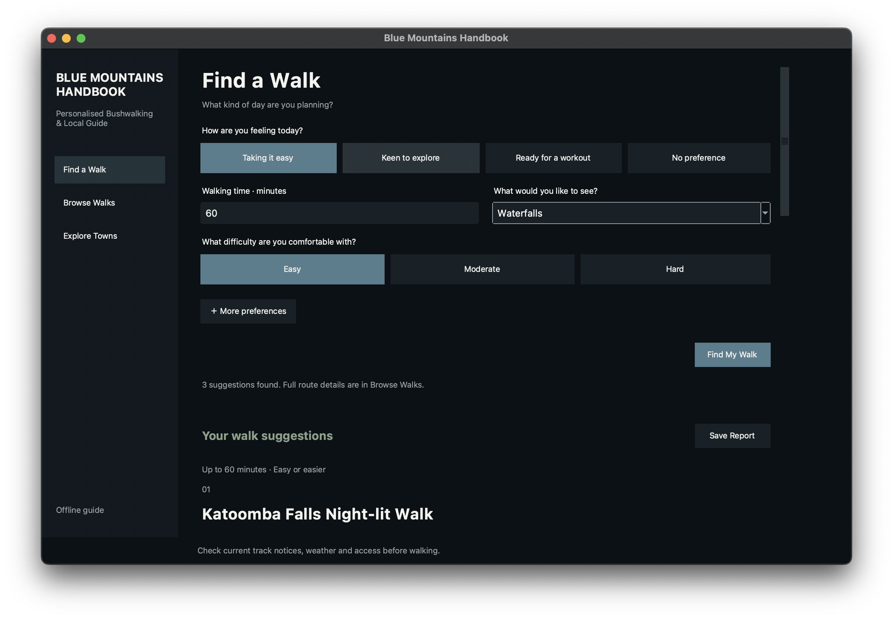
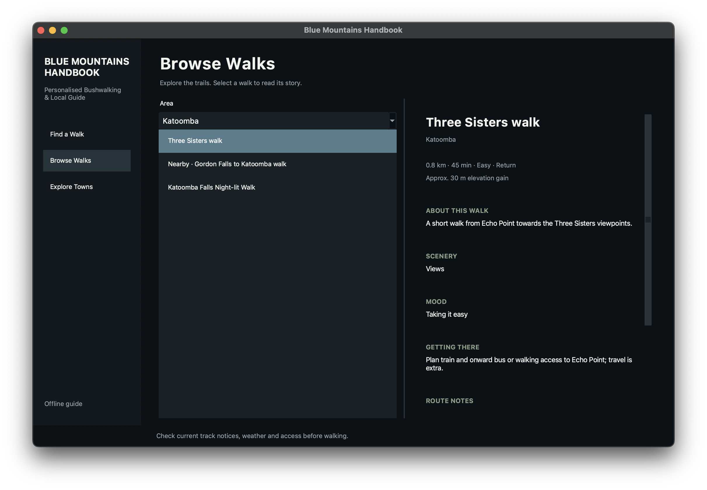
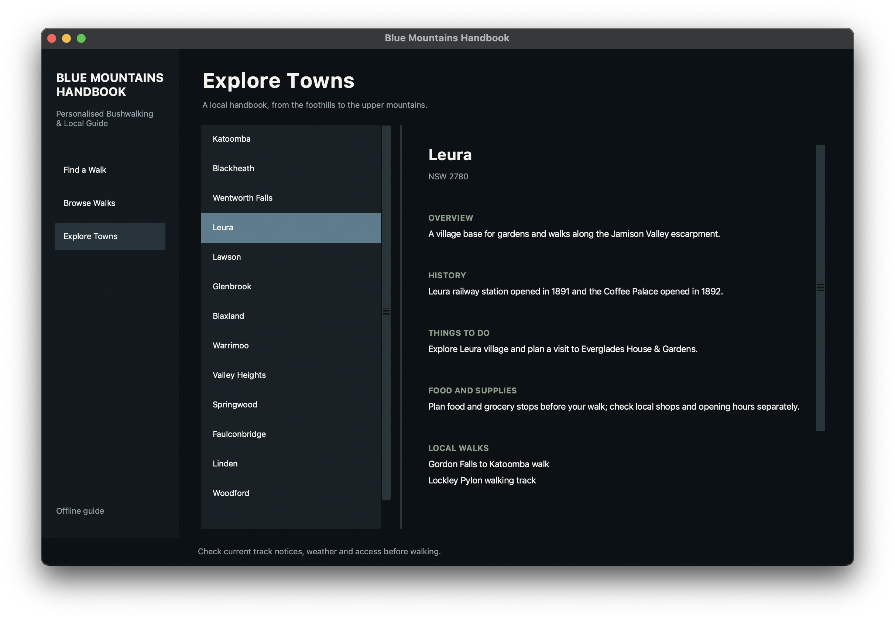
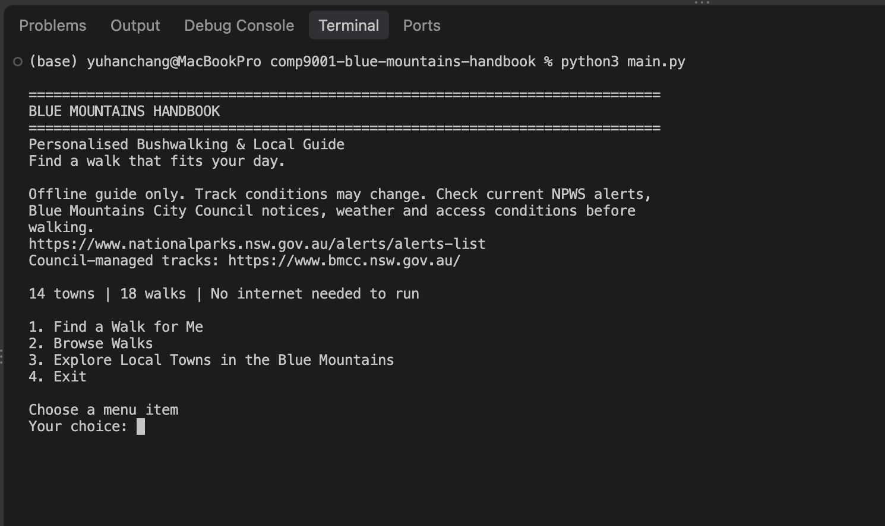

# USYD COMP9001 Final Project - Blue Mountains Handbook 🏔️
## Personalised Bushwalking & Local Guide

**Student:** Yu-Han Chang  
**Student ID:** 540140295  
**Tutorial:** Activity 01 - Niousha Nazemi  
**GitHub Repository:** https://github.com/yuhan0113/comp9001-blue-mountains-handbook

## 🌿 Overview

Blue Mountains Handbook is an offline Python application that helps users explore the Blue Mountains and find a bushwalk suited to their day.

The project contains **18 walks** and information about **14 Blue Mountains towns and areas**. Users can receive personalised walk recommendations, browse the walking catalogue, explore local town information and save recommendation reports.

Recommendations consider:

- current mood
- available walking time
- preferred scenery
- comfortable difficulty
- optional maximum distance
- optional route style

The project provides two interfaces over the same catalogue and recommendation logic:

- an **assessor-friendly terminal interface**
- an optional **Tkinter desktop interface**

No internet connection or third-party Python packages are required.

## 🖥️ Interfaces

### Tkinter Desktop Interface

Run:

```sh
python3 gui.py
```

The optional GUI provides the same core functionality using a dark Blue Mountains-inspired interface.

#### Find a Walk



#### Browse Walks



#### Explore Towns



### ⌨️ Terminal Interface

The terminal version remains the primary assessor-friendly entry point.

Run:

```sh
python3 main.py
```



Both interfaces use the same data files and recommendation backend.

## ⚙️ Requirements

- Python 3.9 or later
- `trails.csv`
- `locations.csv`

Keep all project files in the same folder.

The terminal interface requires only the Python standard library.

The optional GUI uses Python's built-in `tkinter` and `ttk` modules. It therefore requires a graphical desktop environment and a Python installation with working Tkinter support.

No `pip install` step is required.

## 🚀 Running the Program

### Terminal version

Open a terminal in the project folder and run:

```sh
python3 main.py
```

The main menu provides four options:

1. Find a Walk for Me
2. Browse Walks
3. Explore Local Towns in the Blue Mountains
4. Exit

### Graphical version

Run:

```sh
python3 gui.py
```

The GUI provides three main sections:

1. Find a Walk
2. Browse Walks
3. Explore Towns

The GUI may need to be run locally outside Ed's terminal environment because it requires a graphical display.

## 🥾 Find a Walk

For personalised recommendations, users select:

- current mood
- available walking time
- preferred scenery
- comfortable difficulty

Optional preferences include:

- maximum walking distance
- preferred route style

The application validates numeric input and does not silently relax the user's limits.

If no walk fits the selected limits, the program may suggest the shortest additional walking time required while preserving the other preferences. The user must confirm before the time limit is changed.

Up to three recommendations are displayed.

## 📁 Submission Files

- `main.py` — terminal interface, menus, walk and town display, report formatting and saving.
- `gui.py` — optional Tkinter graphical interface.
- `data_loader.py` — reads and validates the CSV catalogue.
- `recommendations.py` — filters, scores and ranks suitable walks.
- `trails.csv` — data for the 18 walking routes.
- `locations.csv` — data for the 14 towns and areas.
- `tests.py` — automated tests for recommendation logic, file handling and terminal interaction.
- `test_gui.py` — GUI helper tests that do not require opening a window.
- `README.md` — project overview and instructions.

`saved_recommendations.txt` is created only when the user chooses to save a recommendation report. It is not required for the initial program run.

## 🧭 Recommendation Logic

Walks are first filtered using three hard limits:

```text
Walking Time
Optional Maximum Distance
Difficulty
```

Difficulty uses three project-defined categories:

```text
Easy < Moderate < Hard
```

An Easy selection includes Easy walks only.

A Moderate selection includes Easy and Moderate walks.

A Hard selection allows all three categories.

Eligible walks are then scored using:

```text
Score = Eligibility + Scenery Match + Mood Match + Route Match
```

The components are:

```text
Eligibility     = 40 points
Scenery Match   = 30 points
Mood Match      = 20 points
Route Match     = 10 points
```

Scenery, mood and route are soft preferences rather than exclusion rules.

If a soft preference does not match, the walk can still be recommended and the difference is explained as a trade-off.

Results are sorted by:

1. descending score
2. ascending walking time
3. alphabetical walk name

Up to three recommendations are displayed.

The score measures **preference fit only**. It is not a safety rating and does not confirm whether a track is currently open.

## 🗺️ Walk Information

Each walk may include:

- distance
- estimated walking time
- Easy, Moderate or Hard difficulty
- route type
- scenery
- mood
- access information
- description
- elevation gain
- source information
- route notes

Elevation is displayed for planning and comparison only. It does not affect filtering, eligibility, scoring or ranking.

All 18 walks have a numeric ascent value.

The catalogue retains the published estimates of:

- **473 m** — Walls Ledge - Porters Pass - Centennial Glen circuit
- **406 m** — Blaxland to Warrimoo via Florabella Pass
- **338 m** — Faulconbridge to Springwood via Sassafras Gully

Other ascent values are deliberately rough **project estimates** for comparison rather than official or measured route totals. These estimates are labelled accordingly in the catalogue.

Transport information is retained as access information but is not used as a recommendation filter.

## 🏘️ Town Information

The application includes information for 14 Blue Mountains towns and areas.

Town entries may include:

- postcode
- overview
- short history
- things to do
- food and supply suggestions
- local walks
- nearby or connecting walks
- reference sources

Nearby or connecting walks are distinguished from walks located directly within the selected town or area.

## 💾 Saved Reports

Users can save their current recommendation results to:

```text
saved_recommendations.txt
```

New reports are appended to the existing file rather than replacing earlier sessions.

The terminal and GUI interfaces use the same report format and save behaviour.

## ⚠️ Safety and Limitations

Blue Mountains Handbook is an offline educational guide.

It does **not** provide live information about:

- track closures
- weather
- bushfire conditions
- flooding
- accessibility
- transport disruptions
- current track condition

Before walking, users should check current information from:

- NSW National Parks and Wildlife Service alerts  
  https://www.nationalparks.nsw.gov.au/alerts/alerts-list
- Blue Mountains City Council  
  https://www.bmcc.nsw.gov.au/

Walking times are planning estimates and do not include travel, breaks or unexpected delays.

The Easy, Moderate and Hard categories are project-defined comparison categories rather than official track grades.

## ✅ Verification

Run the original terminal test suite with:

```sh
python3 tests.py
```

This suite contains **47 automated tests**.

Run complete test discovery with:

```sh
python3 -m unittest discover -v
```

This also includes the four GUI helper tests in `test_gui.py`, giving:

```text
51 tests
OK
```

The final merged version has been verified with all **51 tests passing**.

The tests cover:

- recommendation filtering and ranking
- difficulty limits
- optional preferences
- catalogue validation
- file errors
- saved-report append behaviour
- terminal interaction
- nearby-walk labelling
- elevation handling
- GUI preference conversion
- shared GUI/terminal recommendation behaviour

The project demonstrates advanced Python concepts including:

- **File I/O** — CSV catalogue loading and recommendation report writing
- **Program Testing** — automated tests using the standard-library `unittest` framework
- **Error Handling** — validation of user input, catalogue files and save operations

## 🧩 Project Structure

```text
Blue Mountains Handbook
│
├── main.py
│   └── Terminal interface
│
├── gui.py
│   └── Optional Tkinter interface
│
├── data_loader.py
│   └── Catalogue loading and validation
│
├── recommendations.py
│   └── Filtering, scoring and recommendation logic
│
├── trails.csv
├── locations.csv
│
├── tests.py
├── test_gui.py
│
├── images/
│   ├── gui-find.png
│   ├── gui-browse.png
│   ├── gui-towns.png
│   └── cli.png
│
└── README.md
```

Both interfaces use the same catalogue and recommendation logic. The graphical interface is a presentation layer rather than a separate implementation of the recommendation system.
